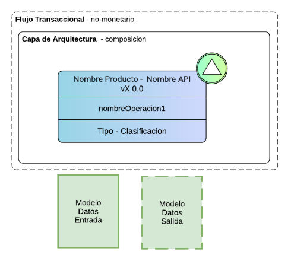
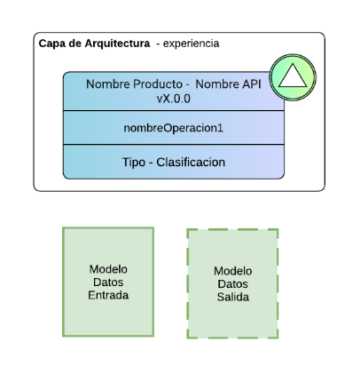
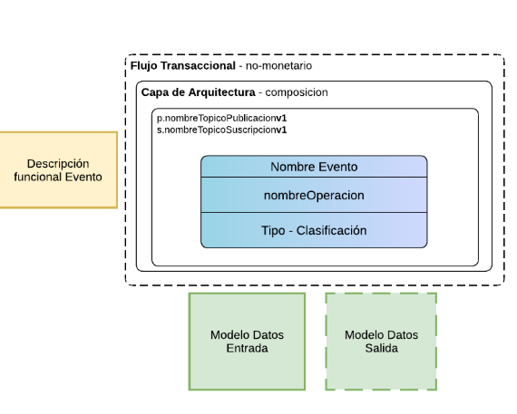
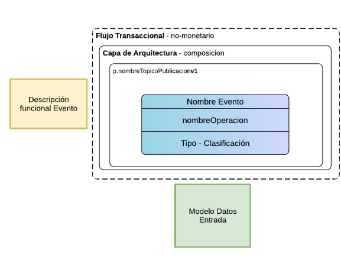
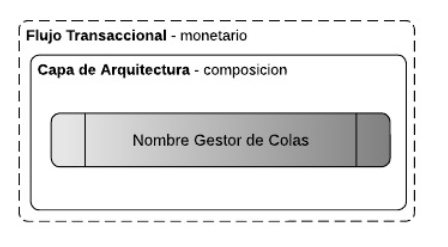
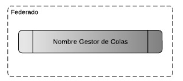
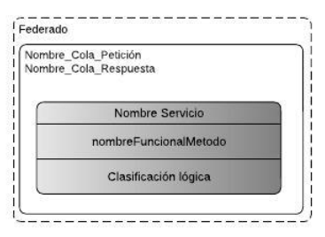
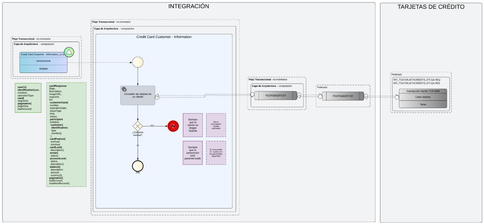
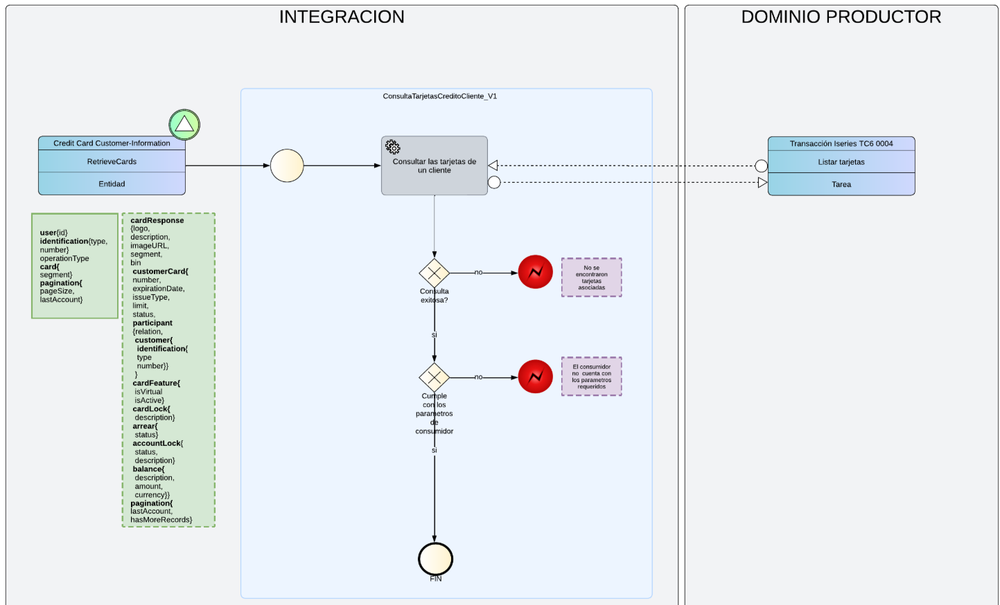

## Capas de Despliegue

### Contenedores de la Capa de Despliegue

Las APIs (Este componente hereda todas las condiciones definidas en el documento `componenteApiPrivada.md`, excepto aquellas reemplazadas explícitamente en el presente documento), Servicios ((Este componente hereda todas las condiciones definidas en el documento `componenteServicioGestionado.md`, excepto aquellas reemplazadas explícitamente en el presente documento)) y Eventos ((Este componente hereda todas las condiciones definidas en el documento `eventos.md`, excepto aquellas reemplazadas explícitamente en el presente documento)) se deben clasificar en un Flujo Transaccional (Monetario, No Monetario, Operativo, Transversal), y en una Capa de Arquitectura (Experiencia, Composición y Sistema).

### Como se modela la capa de despliegue

- El contenedor de la capa es el rectángulo exterior más grande que encapsula todo el contenido del API, Servicio, Evento, Representa la Capa de Despliegue API Partner, es decir, el límite arquitectónico dentro del cual se ubican los flujos, operaciones y componentes relacionados.

En la Vista de la Capa de despliegue se debe agregar los componentes de despliegue encima (superpuesto) de cada API, Servicio, Evento, MQ, etc.

El dominio de valores para los flujos y capas son los siguientes:

Flujos Transaccionales:

* monetario
* no-monetario
* operativo
* transversal

Capas de Arquitectura:

* experiencia
* composicion
* sistema

  - Si los nombres son diferentes a los que están en este listado que es experiencia, composicion o sistema, tal cual está escrito es considerado un error.
  
### Capa de despliegue para API Privada

La capa de despliegue esta conformada por el Flujo Transaccional y dentro de este se encuentra la Capa de Arquitectura
#### Colores:

* Borde:
    HEX: #000000 (negro).
* Fondo: Transparente (fill="none")

**Condiciones**:

La estructura jerarquica debe ser de esta manera:

 FLUJO TRANSACCIONAL
│
└── CAPA DE ARQUITECTURA
    │
    └── API INTERNA

- El Flujo Transaccional es el contenedor más externo y sus caracteristicas son:
 * Borde negro.
 * Estilo punteado/segmentado.
 * Esquinas redondeadas.
 * Sin color de fondo (transparente).
 * Contiene todos los demás elementos que son la Capa de Arquitectura.
 * El nombre del flujo se ubica normalmente en la parte superior izquierda del contenedor externo
 * El Flujo Transaccional debe tener cualquiera de estos nombres despues del termino "Flujo Transaccional -" y debe ser tal cual esta escrito a continuación en minusculas y sin tildes, si no esta definido de esta forma es una inconsistencia:

    * monetario
    * no-monetario
    * operativo
    * transversal

  * El texto debe cumplir con la siguiente estructura: `"Flujo Transaccional - <tipo>"`
  * `<tipo>` debe corresponder a uno de los valores permitidos en el estándar: `monetario`, `no-monetario`, `operativo` o `transversal`.
  * El tipo debe estar en minúscula.
  * Ejemplos válidos: `Flujo Transaccional - monetario`, `Flujo Transaccional - no-monetario`, `Flujo Transaccional - operativo`, `Flujo Transaccional - transversal`. 

- La capa de Arquitectura se encuentra completamente dentro del Flujo Transaccional, Sus características son:
 * Rectángulo con esquinas redondeadas.
 * Borde negro.
 * Sin color de fondo (transparente).
 * Debe envolver todo el flujo o servicio modelado.
 * Visualmente funciona como un marco arquitectónico
 * Dentro de la capa se ubica el componente API Interna representado como un segundo contenedor
 * La Capa de Despliegue siempre debe ser más grande que el componente API.
 * La API Interna debe estar completamente contenida dentro de la capa.
 * Debe existir un margen visual entre el borde de la capa y el borde de la API.
 * La capa no debe superponerse parcialmente al componente; debe contenerlo totalmente.
 * El nombre de la capa se ubica normalmente en la parte superior izquierda del contenedor externo
 * En términos de Blueprint, la Capa de Despliegue representa el contexto o dominio donde vive la API Interna, mientras que el componente API representa el flujo o servicio específico contenido dentro de esa capa
 * Asi como se muestra la imagen debe estar el API Interna con la capa de despliegue inlcuyendo el Flujo Transaccional y la Capa de Arquitectura
 * La capa de Arquiectura debe tener cualquiera de estos nombres despues del termino "Capa de Arquitectura -" y debe ser tal cual esta escrito a continuación en minusculas y sin tildes, si no esta definido de esta forma es una inconsistencia:

  * experiencia
  * composicion
  * sistema

* El texto debe cumplir con la siguiente estructura: `"Capa de Arquitectura - <tipo>"`
*  `<tipo>` debe corresponder a uno de los valores permitidos en el estándar: `experiencia`, `composicion`,  o `sistema`.
* El tipo debe estar en minúscula.
* Ejemplos válidos: `Capa de Arquitectura - experiencia`, `Capa de Arquitectura - composicion`, `Capa de Arquitectura - sistema`. 

### Capa de despliegue para API Publica o Partner

#### Colores:

* Borde:
    HEX: #000000 (negro).
* Fondo: Transparente (fill="none")

**Condiciones**:

La estructura jerarquica debe ser de esta manera:

CAPA DE ARQUITECTURA
    │
    └── API PUBLIC O PARTNER

- La capa de Arquitectura se encuentra completamente dentro del Flujo Transaccional, Sus características son:
 * Rectángulo con esquinas redondeadas.
 * Borde negro.
 * Sin color de fondo (transparente).
 * Debe envolver todo el flujo o servicio modelado.
 * Visualmente funciona como un marco arquitectónico
 * Dentro de la capa se ubica el componente API Interna representado como un segundo contenedor
 * La Capa de Despliegue siempre debe ser más grande que el componente API.
 * La API Interna debe estar completamente contenida dentro de la capa.
 * Debe existir un margen visual entre el borde de la capa y el borde de la API.
 * La capa no debe superponerse parcialmente al componente; debe contenerlo totalmente.
 * El nombre de la capa se ubica normalmente en la parte superior izquierda del contenedor externo
 * En términos de Blueprint, la Capa de Despliegue representa el contexto o dominio donde vive la API Interna, mientras que el componente API representa el flujo o servicio específico contenido dentro de esa capa
 * Asi como se muestra la imagen debe estar el API Interna con la capa de despliegue inlcuyendo el Flujo Transaccional y la Capa de Arquitectura
 * La capa de Arquiectura debe tener cualquiera de estos nombres despues del termino "Capa de Arquitectura -" y debe ser tal cual esta escrito a continuación en minusculas y sin tildes, si no esta definido de esta forma es una inconsistencia:

  * experiencia
  * composicion
  * sistema

* El texto debe cumplir con la siguiente estructura: `"Capa de Arquitectura - <tipo>"`
*  `<tipo>` debe corresponder a uno de los valores permitidos en el estándar: `experiencia`, `composicion`,  o `sistema`.
* El tipo debe estar en minúscula.
* Ejemplos válidos: `Capa de Arquitectura - experiencia`, `Capa de Arquitectura - composicion`, `Capa de Arquitectura - sistema`. 

- Asi como se muestra la imagen debe estar el API Pública o Partner con la capa de despliegue inlcuyendo solamente la Capa de Arquitectura

### Capa de despliegue para Evento Comportamiento Con Respuesta

#### Colores:

* Borde:
    HEX: #000000 (negro).
* Fondo: Transparente (fill="none")

**Condiciones**:

La estructura jerarquica debe ser de esta manera:

Flujo Transaccional
    │
    └── Capa de Arquitectura
        │
        └── Evento con Respuesta (nombreTopicoPublicacion y nombreTopicoSuscripcion)

- El Flujo Transaccional es el contenedor más externo y sus caracteristicas son:
 * Borde negro.
 * Estilo punteado/segmentado.
 * Esquinas redondeadas.
 * Sin color de fondo (transparente).
 * Contiene todos los demás elementos que son la Capa de Arquitectura.
 * El nombre del flujo se ubica normalmente en la parte superior izquierda del contenedor externo
 * El Flujo Transaccional debe tener cualquiera de estos nombres despues del termino "Flujo Transaccional -" y debe ser tal cual esta escrito a continuación en minusculas y sin tildes, si no esta definido de esta forma es una inconsistencia:

    * monetario
    * no-monetario
    * operativo
    * transversal
  * El texto debe cumplir con la siguiente estructura: `"Flujo Transaccional - <tipo>"`
  * `<tipo>` debe corresponder a uno de los valores permitidos en el estándar: `monetario`, `no-monetario`, `operativo` o `transversal`.
  * El tipo debe estar en minúscula.
  * Ejemplos válidos: `Flujo Transaccional - monetario`, `Flujo Transaccional - no-monetario`, `Flujo Transaccional - operativo`, `Flujo Transaccional - transversal`. 

- La capa de Arquitectura se encuentra completamente dentro del Flujo Transaccional, Sus características son:
 * Rectángulo con esquinas redondeadas.
 * Borde negro.
 * Sin color de fondo (transparente).
 * Debe envolver todo el flujo o servicio modelado.
 * Visualmente funciona como un marco arquitectónico
 * Dentro de la capa se ubica el componente API Interna representado como un segundo contenedor
 * La Capa de Despliegue siempre debe ser más grande que el componente API.
 * La API Interna debe estar completamente contenida dentro de la capa.
 * Debe existir un margen visual entre el borde de la capa y el borde de la API.
 * La capa no debe superponerse parcialmente al componente; debe contenerlo totalmente.
 * El nombre de la capa se ubica normalmente en la parte superior izquierda del contenedor externo
 * En términos de Blueprint, la Capa de Despliegue representa el contexto o dominio donde vive la API Interna, mientras que el componente API representa el flujo o servicio específico contenido dentro de esa capa
 * Asi como se muestra la imagen debe estar el API Interna con la capa de despliegue inlcuyendo el Flujo Transaccional y la Capa de Arquitectura
 * La capa de Arquiectura debe tener cualquiera de estos nombres despues del termino "Capa de Arquitectura -" y debe ser tal cual esta escrito a continuación en minusculas y sin tildes, si no esta definido de esta forma es una inconsistencia:

  * experiencia
  * composicion
  * sistema

* El texto debe cumplir con la siguiente estructura: `"Capa de Arquitectura - <tipo>"`
*  `<tipo>` debe corresponder a uno de los valores permitidos en el estándar: `experiencia`, `composicion`,  o `sistema`.
* El tipo debe estar en minúscula.
* Ejemplos válidos: `Capa de Arquitectura - experiencia`, `Capa de Arquitectura - composicion`, `Capa de Arquitectura - sistema`. 

- Asi como se muestra la imagen debe estar el API Interna con la capa de despliegue incluyendo el Flujo Transaccional y la Capa de Arquitectura
- El Evento comportamiento con respuesta debe tener el nombre del Tópico de publicacion y debe estar dentro del 3 recuadro que se encuentra en la capa de despliegue
- El Evento comportamiento con respuesta debe tener el nombre del Tópico de suscripcion y debe estar dentro del 3 recuadro que se encuentra en la capa de despliegue

### Capa de despliegue para Evento Comportamiento Sin Respuesta

#### Colores:

* Borde:
    HEX: #000000 (negro).
* Fondo: Transparente (fill="none")

**Condiciones**:

La estructura jerarquica debe ser de esta manera:

Flujo Transaccional
    │
    └── Capa de Arquitectura
        │
        └── Evento con Respuesta (nombreTopicoPublicacion y nombreTopicoSuscripcion)

- El Flujo Transaccional es el contenedor más externo y sus caracteristicas son:
 * Borde negro.
 * Estilo punteado/segmentado.
 * Esquinas redondeadas.
 * Sin color de fondo (transparente).
 * Contiene todos los demás elementos que son la Capa de Arquitectura.
 * El nombre del flujo se ubica normalmente en la parte superior izquierda del contenedor externo
 * El Flujo Transaccional debe tener cualquiera de estos nombres despues del termino "Flujo Transaccional -" y debe ser tal cual esta escrito a continuación en minusculas y sin tildes, si no esta definido de esta forma es una inconsistencia:

    * monetario
    * no-monetario
    * operativo
    * transversal
  * El texto debe cumplir con la siguiente estructura: `"Flujo Transaccional - <tipo>"`
  * `<tipo>` debe corresponder a uno de los valores permitidos en el estándar: `monetario`, `no-monetario`, `operativo` o `transversal`.
  * El tipo debe estar en minúscula.
  * Ejemplos válidos: `Flujo Transaccional - monetario`, `Flujo Transaccional - no-monetario`, `Flujo Transaccional - operativo`, `Flujo Transaccional - transversal`. 

- La capa de Arquitectura se encuentra completamente dentro del Flujo Transaccional, Sus características son:
 * Rectángulo con esquinas redondeadas.
 * Borde negro.
 * Sin color de fondo (transparente).
 * Debe envolver todo el flujo o servicio modelado.
 * Visualmente funciona como un marco arquitectónico
 * Dentro de la capa se ubica el componente API Interna representado como un segundo contenedor
 * La Capa de Despliegue siempre debe ser más grande que el componente API.
 * La API Interna debe estar completamente contenida dentro de la capa.
 * Debe existir un margen visual entre el borde de la capa y el borde de la API.
 * La capa no debe superponerse parcialmente al componente; debe contenerlo totalmente.
 * El nombre de la capa se ubica normalmente en la parte superior izquierda del contenedor externo
 * En términos de Blueprint, la Capa de Despliegue representa el contexto o dominio donde vive la API Interna, mientras que el componente API representa el flujo o servicio específico contenido dentro de esa capa
 * Asi como se muestra la imagen debe estar el API Interna con la capa de despliegue inlcuyendo el Flujo Transaccional y la Capa de Arquitectura
 * La capa de Arquiectura debe tener cualquiera de estos nombres despues del termino "Capa de Arquitectura -" y debe ser tal cual esta escrito a continuación en minusculas y sin tildes, si no esta definido de esta forma es una inconsistencia:

  * experiencia
  * composicion
  * sistema

* El texto debe cumplir con la siguiente estructura: `"Capa de Arquitectura - <tipo>"`
*  `<tipo>` debe corresponder a uno de los valores permitidos en el estándar: `experiencia`, `composicion`,  o `sistema`.
* El tipo debe estar en minúscula.
* Ejemplos válidos: `Capa de Arquitectura - experiencia`, `Capa de Arquitectura - composicion`, `Capa de Arquitectura - sistema`. 

- Asi como se muestra la imagen debe estar el API Interna con la capa de despliegue incluyendo el Flujo Transaccional y la Capa de Arquitectura
- El Evento comportamiento con respuesta debe tener el nombre del Tópico de publicacion y debe estar dentro del 3 recuadro que se encuentra en la capa de despliegue

### Capa de despliegue para Servicio

- Asi como se muestra la imagen debe estar el servicio con la capa de despliegue inlcuyendo el Flujo Transaccional y la Capa de Arquitectura

#### Colores:

* Borde:
    HEX: #000000 (negro).
* Fondo: Transparente (fill="none")

**Condiciones**:

La estructura jerarquica debe ser de esta manera:

 FLUJO TRANSACCIONAL
│
└── CAPA DE ARQUITECTURA
    │
    └── SERVICIO

- El Flujo Transaccional es el contenedor más externo y sus caracteristicas son:
 * Borde negro.
 * Estilo punteado/segmentado.
 * Esquinas redondeadas.
 * Sin color de fondo (transparente).
 * Contiene todos los demás elementos que son la Capa de Arquitectura.
 * El nombre del flujo se ubica normalmente en la parte superior izquierda del contenedor externo
 * El Flujo Transaccional debe tener cualquiera de estos nombres despues del termino "Flujo Transaccional -" y debe ser tal cual esta escrito a continuación en minusculas y sin tildes, si no esta definido de esta forma es una inconsistencia:

    * monetario
    * no-monetario
    * operativo
    * transversal

  * El texto debe cumplir con la siguiente estructura: `"Flujo Transaccional - <tipo>"`
  * `<tipo>` debe corresponder a uno de los valores permitidos en el estándar: `monetario`, `no-monetario`, `operativo` o `transversal`.
  * El tipo debe estar en minúscula.
  * Ejemplos válidos: `Flujo Transaccional - monetario`, `Flujo Transaccional - no-monetario`, `Flujo Transaccional - operativo`, `Flujo Transaccional - transversal`. 
*

- La capa de Arquitectura se encuentra completamente dentro del Flujo Transaccional, Sus características son:
 * Rectángulo con esquinas redondeadas.
 * Borde negro.
 * Sin color de fondo (transparente).
 * Debe envolver todo el flujo o servicio modelado.
 * Visualmente funciona como un marco arquitectónico
 * Dentro de la capa se ubica el componente API Interna representado como un segundo contenedor
 * La Capa de Despliegue siempre debe ser más grande que el componente API.
 * La API Interna debe estar completamente contenida dentro de la capa.
 * Debe existir un margen visual entre el borde de la capa y el borde de la API.
 * La capa no debe superponerse parcialmente al componente; debe contenerlo totalmente.
 * El nombre de la capa se ubica normalmente en la parte superior izquierda del contenedor externo
 * En términos de Blueprint, la Capa de Despliegue representa el contexto o dominio donde vive la API Interna, mientras que el componente API representa el flujo o servicio específico contenido dentro de esa capa
 * Asi como se muestra la imagen debe estar el API Interna con la capa de despliegue inlcuyendo el Flujo Transaccional y la Capa de Arquitectura
 * La capa de Arquiectura debe tener cualquiera de estos nombres despues del termino "Capa de Arquitectura -" y debe ser tal cual esta escrito a continuación en minusculas y sin tildes, si no esta definido de esta forma es una inconsistencia:

  * experiencia
  * composicion
  * sistema

* El texto debe cumplir con la siguiente estructura: `"Capa de Arquitectura - <tipo>"`
*  `<tipo>` debe corresponder a uno de los valores permitidos en el estándar: `experiencia`, `composicion`,  o `sistema`.
* El tipo debe estar en minúscula.
* Ejemplos válidos: `Capa de Arquitectura - experiencia`, `Capa de Arquitectura - composicion`, `Capa de Arquitectura - sistema`. 
- Asi como se muestra la imagen debe estar el API Interna con la capa de despliegue incluyendo el Flujo Transaccional y la Capa de Arquitectura

### Capa de despliegue para Componentes Tecnológicos de Integración

####  Gestor de Colas (Queue Manager)

#### Colores:

* Borde:
    HEX: #000000 (negro).
* Fondo: Transparente (fill="none")

**Condiciones**:

La estructura jerarquica debe ser de esta manera:

 FLUJO TRANSACCIONAL
│
└── CAPA DE ARQUITECTURA
    │
    └── GESTOR DE COLAS

- El Flujo Transaccional es el contenedor más externo y sus caracteristicas son:
 * Borde negro.
 * Estilo punteado/segmentado.
 * Esquinas redondeadas.
 * Sin color de fondo (transparente).
 * Contiene todos los demás elementos que son la Capa de Arquitectura.
 * El nombre del flujo se ubica normalmente en la parte superior izquierda del contenedor externo
 * El Flujo Transaccional debe tener cualquiera de estos nombres despues del termino "Flujo Transaccional -" y debe ser tal cual esta escrito a continuación en minusculas y sin tildes, si no esta definido de esta forma es una inconsistencia:

    * monetario
    * no-monetario
    * operativo
    * transversal

  * El texto debe cumplir con la siguiente estructura: `"Flujo Transaccional - <tipo>"` 
  *  `<tipo>` debe corresponder a uno de los valores permitidos en el estándar: `monetario`, `no-monetario`, `operativo` o `transversal`.
  * El tipo debe estar en minúscula.
  * Ejemplos válidos: `Flujo Transaccional - monetario`, `Flujo Transaccional - no-monetario`, `Flujo Transaccional - operativo`, `Flujo Transaccional - transversal`. 

- La capa de Arquitectura se encuentra completamente dentro del Flujo Transaccional, Sus características son:
 * Rectángulo con esquinas redondeadas.
 * Borde negro.
 * Sin color de fondo (transparente).
 * Debe envolver todo el flujo o servicio modelado.
 * Visualmente funciona como un marco arquitectónico
 * Dentro de la capa se ubica el componente API Interna representado como un segundo contenedor
 * La Capa de Despliegue siempre debe ser más grande que el componente API.
 * La API Interna debe estar completamente contenida dentro de la capa.
 * Debe existir un margen visual entre el borde de la capa y el borde de la API.
 * La capa no debe superponerse parcialmente al componente; debe contenerlo totalmente.
 * El nombre de la capa se ubica normalmente en la parte superior izquierda del contenedor externo
 * En términos de Blueprint, la Capa de Despliegue representa el contexto o dominio donde vive la API Interna, mientras que el componente API representa el flujo o servicio específico contenido dentro de esa capa
 * Asi como se muestra la imagen debe estar el API Interna con la capa de despliegue inlcuyendo el Flujo Transaccional y la Capa de Arquitectura
 * La capa de Arquiectura debe tener cualquiera de estos nombres despues del termino "Capa de Arquitectura -" y debe ser tal cual esta escrito a continuación en minusculas y sin tildes, si no esta definido de esta forma es una inconsistencia:

  * experiencia
  * composicion
  * sistema

  * El texto debe cumplir con la siguiente estructura: `"Capa de Arquitectura - <tipo>"`
*  `<tipo>` debe corresponder a uno de los valores permitidos en el estándar: `experiencia`, `composicion`,  o `sistema`.
* El tipo debe estar en minúscula.
* Ejemplos válidos: `Capa de Arquitectura - experiencia`, `Capa de Arquitectura - composicion`, `Capa de Arquitectura - sistema`. 

- Asi como se muestra la imagen debe estar el API Interna con la capa de despliegue incluyendo el Flujo Transaccional y la Capa de Arquitectura

#### APIS, Servicios y Gestores de Cola no Federedos

- Si existe algun componente como un API, Servicio o Gestor de colas que no se encuentra en la infraestructra centralizada no debe tener la capa de despliegue porque aun se encuentra en una infraestuctura federada, pero si debe tener un recuadro con lineas discontinuas indicando que es Federado.
- Los servicios que aún residen en la infraestructura federada no incluyen flujo transaccional ni capa de arquitectura, ya que no están desplegados en la infraestructura centralizada. No obstante, si el mecanismo de consumo se realiza a través de colas de mensajería en el Gestor de Colas (Queue Manager) de Integración, se complementa con la capa genérica "Federado" y los nombres de las colas de petición y respuesta utilizadas para la comunicación.

### Ejemplo Modelo de BluePrint en Infrestructura de Modelo Centralizado de integración

### Ejemplo Modelo de BluePrint en Infrestructura Federada

