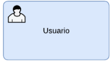
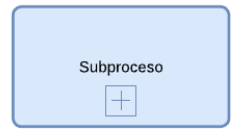

# REGLAS BLUEPRINT API

## Comandos y Subprocesos

Representan intenciones/acciones/decisiones o consultas que se debe ejecutar durante un flujo.

### 1. **Comando de consulta:**

#### Colores:

* Fondo:#CED4DB (gris claro azulado).
    HEX: #ced4db
    RGB: (206, 212, 219)
* Borde:
    HEX: #6F7681 (gris oscuro azulado).
    RGB:  (111, 118, 129)
* Color relleno engranaje: #FFFFFF
    HEX:#FFFFFF
 
**Condiciones**:
- El objeto comando de tipo consulta esta representado por un un rectángulo con esquinas redondeadas
- El comando de tipo consulta dentro del contenedor aparecen dos símbolos tipo engranaje superpuestos blancos con borde negro ubicados en la parte superior izquierda del contenedor. 
- Cada engranaje tiene un círculo central
- Este comando de tipo consulta representa una actividad que obtiene o consulta informacion especifica.
- El comando de tipo consulta se nombra con verbo infinitivo + un sustantivo. Ejemplo: “Consultar cuenta”, “Consultar pago” o “Consultar saldo”.
- Los colores utilizado en el comando de tipo consulta deben corresponder completamente a una de las paletas definidas en la sección **Colores**.
- Este comando de tipo sistema debe tener 2 lineas que pueden comunicarse con otro comando o proceso, estas lineas interlineadas deben ser 2 e ir en ambos sentidos
- El texto que se incluye en el comando de tipo consulta debe iniciar siempre en mayúsculas
- El comando de tipo consulta siempre debe tener el piñon y cumplir con el icono de la imagen
- Todo lo que tenga terminos similares a consulta, consultar consultas, validar, validacion debe ser incluidos en este objeto comando tipo consulta en color gris con valor hexadecimal  #CED4DB si está en otro color debe notificarse como un no cumplimiento.
-

### 2. **Sistema Automatizado:**

#### Colores:

* Fondo:#DAE8FC (gris claro azulado).
    HEX: DAE8FC
    RGB: (218,232,252)
* Borde:
    HEX: #6C8EBF (gris oscuro azulado).
    RGB:  (108,142,191)
* Color relleno engranaje: #FFFFFF
    HEX:#FFFFFF
 
**Condiciones**:
- Este comando tipo Sistema Automatizado esta representado por un Rectángulo con esquinas redondeadas
- Este comando tipo Sistema Automatizado se identifican dos engranajes superpuestos blancos con borde negro ubicados en la parte superior izquierda del contenedor.
- Este comando tipo Sistema Automatizado representa una actividad que puede ser sistematizada a través de una capacidad de API o Servicio
- El comando de tipo Sistema Automatizado con engranaje se nombra con verbo infinitivo + un sustantivo. Ejemplo: “Debitar cuenta”, “Validar cuenta” o “Realizar pago” 
- Los colores utilizados en el comando de tipo Sistema Automatizado deben corresponder completamente a una de las paletas definidas en la sección **Colores**.
- Este comando de tipo sistema debe tener 2 lineas que pueden comunicarse con otro comando o proceso, estas lineas interlineadas deben ser 2 e ir en ambos sentidos
- El texto que se incluye en el comando tipo Sistema Automatizado con engranaje debe iniciar en mayúsculas
- Este comando de tipo Sistema Automatizado debe tener 2 lineas que pueden comunicarse con otro comando o proceso, estas lineas deben ser interlineadas y deben ser 2 e ir en ambos sentidos

### 3. **Usuario:**

#### Colores:

* Fondo:#DAE8FC (gris claro azulado).
    HEX: DAE8FC
    RGB: (218, 232, 252)
* Borde:
    HEX: #6C8EBF (gris oscuro azulado).
    RGB:  (108,142,191)
* Color relleno engranaje: #FFFFFF
    HEX:#FFFFFF

**Condiciones:**
- Este comando de tipo usuario es un contenedor rectangular con esquinas redondeadas.
- Este comando de tipo usuario  cuenta con un ícono de usuario/persona en la parte superior izquierda.
- Este comando de tipo usuario representa una actividad que requiere la interaccion del usuario de forma manual
- El texto que se incluye en el comando de tipo usuario debe iniciar siempre en Mayúscula
- El comando de tipo usuario se nombra con verbo infinitivo + un sustantivo. Ejemplo: “Revisar Reporte”, “Validar Información”.
- Este comando de tipo sistema debe tener 2 lineas que pueden comunicarse con otro comando o proceso, estas lineas interlineadas deben ser 2 e ir en ambos sentidos
- Los colores utilizados en el comando de tipo usuario deben corresponder completamente a una de las paletas definidas en la sección **Colores**.

### 4. **Sistema:**

#### Colores:

* Fondo:#DAE8FC (gris claro azulado).
    HEX: DAE8FC
    RGB: (218, 232, 252)
* Borde:
    HEX: #6C8EBF (gris oscuro azulado).
    RGB:  (108,142,191)
* Color relleno engranaje: #FFFFFF
    HEX:#FFFFFF

**Condiciones:**
- Este comando de tipo sistema es un contenedor rectangular con esquinas redondeadas.
- Este comando de tipo sistema  es un contenedor vacio sin iconos
- Este comando de tipo sistema representa una actividad de sistema que no implica interaccion de usuario ni uso de APIS o servicios, es usado para representar conexiones a Bases de datos
- El texto que se incluye en el comando de tipo sistema debe iniciar siempre en Mayúscula
- Este comando de tipo sistema debe tener 2 lineas que pueden comunicarse con otro comando o proceso, estas lineas interlineadas deben ser 2 e ir en ambos sentidos
- Este comando de tipo Sistema siempre debe ir en color azul su valor hexadecimal debe ser #DAE8FC.
- Los colores utilizados en el comando de tipo Sistema deben corresponder completamente a una de las paletas definidas en la sección **Colores**.

### 5. **Subproceso:**

#### Colores:

* Fondo:#DAE8FC (gris claro azulado).
    HEX: DAE8FC
    RGB: (218, 232, 252)
* Borde:
    HEX: #6C8EBF (gris oscuro azulado).
    RGB:  (108,142,191)
* Color relleno engranaje: #FFFFFF
    HEX:#FFFFFF

**Condiciones:**
- Este comando de tipo subproceso es un contenedor rectangular con esquinas redondeadas.
- Este comando de tipo subproceso  es un contenedor con un icono con un símbolo "+" dentro de un cuadrado, típico de BPMN que Se encuentra en la parte inferior-central del artefacto
- Este comando de tipo subproceso encapsula un subconjunto de actividades que se realizan para cumplir un objetivo dentro de un proceso mas grande
- Los colores utilizados en el comando de tipo subproceso deben corresponder completamente a una de las paletas definidas en la sección **Colores**.
- El texto que se incluye en el comando de tipo subproceso debe iniciar siempre en Mayúscula
- Este comando de tipo subproceso debe tener 2 lineas que pueden comunicarse con otro comando o proceso, estas lineas interineadas deben ser 2 e ir en ambos sentidos