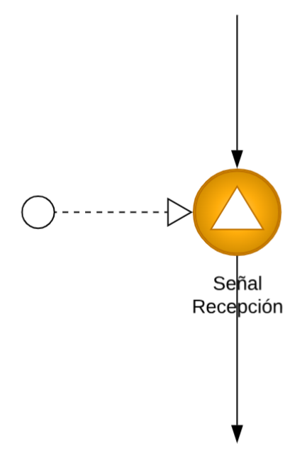
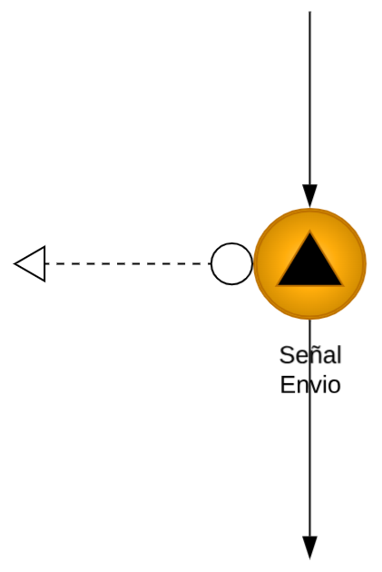
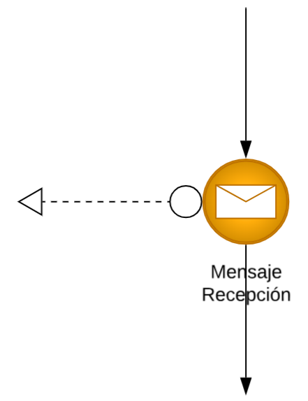
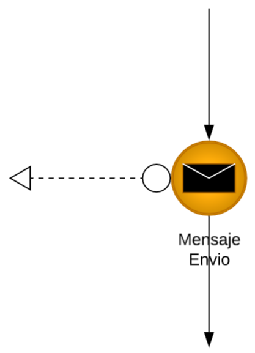

# REGLAS BLUEPRINT API

## Eventos

### Descripción general
- Un evento es un suceso significativo que ocurre en un sistema en un momento específico y que merece ser capturado y procesado.
- Los tipos de eventos son: 
    1. Simples
    2. Señal
    3. Mensaje
- Los eventos simples pueden ser de dominio o excepción.
- Los eventos de señal y mensaje pueden ser de recepción o envío.

### 1. **Evento tipo simple de dominio**

**Colores**

Borde:
- HEX: #bd7000
- RGB: 189,112,0

Relleno:
Gradiente radial compuesto por:
- #ffcd6a
- #ffad0b
- #d08b00

**Condiciones**:
- Reflejan un cambio de estado relevante en el sistema o funcionalidad modelada.
- Tiene forma circular
- Tiene borde simple
- No debe contener íconos internos.
- Debe utilizar los colores definidos en la sección **Colores**.
- Debe estar conectado mediante una línea contínua en sus extremos.
- La conexión de un extremo debe provenir de una compuerta exclusiva, paralela, un comando de tipo sistema automatizado, un comando de tipo sistema.
- La conexión del otro extremo debe estar unida a otro componente o artefacto del blueprint.
- Debe representar una operación completada exitosamente sobre una entidad o activo del dominio.
- El texto asociado al evento debe construirse utilizando la siguiente estructura: "Entidad o Activo" + "Verbo en pasado".
- Ejemplos válidos: Cliente creado, Cuenta creada, Cuenta eliminada, Cliente modificado, Inversión actualizada, Crédito actualizado.
- Ejemplos no válidos: Crear cliente, Crear cuenta, Eliminar cuenta, Actualización de crédito.
- Debe estar ubicado exlusivamente dentro de un contenedor hijo correspondiente al servicio gestionado o no gestionado que se este modelando (Ver documento `contenedores.md`).

### 2. **Evento tipo simple de excepción**

**Colores**

Borde:
- HEX: #bf0808
- RGB: 191,8,8

Relleno:
Gradiente radial compuesto por:
- #ff8f8f
- #e81313
- #bf0808

Icono interno:
- Rayo de color rojo.
- HEX: #bf0808
- RGB: 191,8,8

**Condiciones**:
- Refleja que el sistema ha generado un fallo o una condición inesperada que impide continuar normalmente la ejecución del proceso.
- Tiene forma circular.
- Tiene borde simple de color rojo.
- Contiene un icono interno de rayo.
- Debe utilizar los colores definidos en la sección **Colores**.
- Debe estar conectado mediante una línea continua en uno de sus extremos (vertical u horizontal) a un componente o artefacto.
- La conexión principal puede provenir de un comando de tipo sistema que representa un SPR (Ver documento `componentesIntegracion.md`.) o de compuerta exclusiva (Ver documento `compuertas.md`.) cuya evaluación a la pregunta asociada resulte en una condición de fallo, error o incumplimiento de una validación requerida para continuar el proceso.
- En el extremo opuesto a la conexión principal, debe estar asociado obligatoriamente a un modelo de mensaje de excepción. Sus colores, formas y textos válidos se encuentran en el documento `modelosLectura.md`.
- Debe estar ubicado exlusivamente dentro de un contenedor hijo correspondiente al servicio gestionado o no gestionado que se este modelando (Ver documento `contenedores.md`).

### 3. **Evento tipo señal de recepción**

**Colores**

Borde:
- HEX: #bd7000
- RGB: 189,112,0

Relleno:
Gradiente radial compuesto por:
- #ffcd6a
- #ffad0b
- #d08b00

Icono interno:
- Triángulo color blanco.
- HEX: #ffffff
- RGB: 255,255,255

**Condiciones:**
- Refleja que el sistema está esperando recibir algo para continuar con el proceso.
- Se utiliza para modelar recepción de eventos exclusivamente. Estos pueden ser de tipo query, command o event.
- Tiene forma circular.
- Tiene borde simple color dorado.
- Contiene un triángulo interno color blanco.
- Debe utilizar los colores definidos en la sección **Colores**.
- Debe estar conectado mediante una línea continua vertical superior y una línea continua vertical inferior.
- Adicionalmente debe existir una línea discontinua conectada por uno de sus laterales.
- En la línea discontinua, el triángulo sin relleno debe apuntar hacia el evento tipo señal recepción.
- El círculo sin relleno debe apuntar hacia el componente utilizado para modelar eventos tipo query, event o command que genera la señal.
- La conexión superior debe provenir de una compuerta basada en eventos o paralela basada en eventos.
- La conexión inferior debe estar unida a otro componente o artefacto del blueprint.
- El componente debe tener un texto asociado.
- El texto asociado al evento debe describir el resultado recibido por el proceso.
- El texto asociado al evento debe construirse utilizando la siguiente estructura: Activo que tuvo el cambio de estado + verbo en pasado.
- Cuando la señal corresponda a la respuesta de un query o command, el texto debe representar el resultado recibido por el proceso. Ejemplos válidos: Historial crediticio consultado, Cupo actualizado, Cliente creado, Tarjeta cancelada.
- Cuando la señal corresponda a una suscripción de un evento, el texto debe corresponder al nombre del evento recibido. Ejemplos válidos: Cliente creado, Tarjeta cancelada.
- Ejemplos no válidos: Consultar historial crediticio, Actualizar cupo, Crear cliente.
- Debe estar ubicado exlusivamente dentro de un contenedor hijo correspondiente al servicio gestionado o no gestionado que se este modelando (Ver documento `contenedores.md`).

### 4. **Evento tipo señal de envío**

**Colores**

Borde:
- HEX: #bd7000
- RGB: 189,112,0

Relleno:
Gradiente radial compuesto por:
- #ffcd6a
- #ffad0b
- #d08b00

Icono interno:
- Triángulo color negro.
- HEX: #000000
- RGB: 0,0,0

**Condiciones:**
- Refleja que el sistema envía una señal o un cambio de estado para que sea tomado por otro sistema.
- Se utiliza para modelar el envío de señales asociadas a eventos de tipo query, command o event.
- Tiene forma circular.
- Tiene borde simple color dorado.
- Contiene un triángulo interno color negro.
- Debe utilizar los colores definidos en la sección **Colores**.
- Debe estar conectado mediante una línea continua vertical superior y una línea continua vertical inferior.
- Adicionalmente debe existir una línea discontinua conectada por uno de sus laterales.
- En la línea discontinua, el triángulo sin relleno debe apuntar hacia el componente utilizado para modelar eventos tipo query, command o event.
- El círculo sin relleno debe apuntar hacia el evento tipo señal envío.
- La conexión superior debe provenir de cualquier componente o artefacto del blueprint.
- La conexión inferior debe estar unida a otro componente o artefacto del blueprint cuando el componente al que se encuentra relacionado la linea discontinua corresponda al modelamiento de un evento de tipo event o command.
- Si el componente al que se encuentra relacionado la linea discontinua corresponde al modelamiento de un evento de tipo query, la conexión inferior debe estar unida a una compuesta basada en eventos.
- El componente debe tener un texto asociado.
- El texto debe describir la señal o evento enviado por el proceso.
- Cuando el componente al que se encuentra relacionado la linea discontinua corresponda al modelamiento de un evento de tipo query o command, el texto asociado al evento debe construirse utilizando la siguiente estructura: verbo en infinitivo + activo sobre el cual se realizará la acción. Ejemplos válidos: Consultar historia crediticio, Actualizar cupo, Crear cliente.
- Cuando el componente al que se encuentra relacionado la linea discontinua corresponda al modelamiento de un evento de tipo event, el texto asociado al evento debe construirse utilizando la siguiente estructura: Activo que tuvo el cambio de estado + verbo en pasado. Ejemplos válidos: Cupo actualizado, Cliente creado, Tarjeta cancelada.
- Debe estar ubicado exlusivamente dentro de un contenedor hijo correspondiente al servicio gestionado o no gestionado que se este modelando (Ver documento `contenedores.md`).

### 5. **Evento tipo mensaje de recepción**

**Colores**

Borde del evento:
- HEX: #bd7000
- RGB: 189,112,0

Relleno del evento:
Gradiente radial compuesto por:
- #ffcd6a
- #ffad0b
- #d08b00

Icono interno (sobre):

Borde:
- HEX: #bd7000
- RGB: 189,112,0

Relleno:
- HEX: #ffffff
- RGB: 255,255,255

**Condiciones:**
- Refleja que el sistema está esperando recibir algo para continuar con el proceso.
- Se utiliza para modelar recepción de mensajes asíncronos diferentes a eventos como callbacks.
- No debe utilizarse para modelar eventos de negocio publicados o suscritos.
- Tiene forma circular.
- Tiene borde simple color dorado.
- Contiene un sobre interno color blanco.
- Debe utilizar los colores definidos en la sección **Colores**.
- Debe estar conectado mediante una línea continua vertical superior y una línea continua vertical inferior.
- Adicionalmente debe existir una línea discontinua conectada por uno de sus laterales.
- En la línea discontinua, el triángulo sin relleno debe apuntar hacia el componente de integración desde donde se va a leer el mensaje, como por ejemplo un gestor de colas.
- El círculo sin relleno del otro extremo de la linea discontinua, debe apuntar hacia el evento de tipo mensaje de recepción.
- La conexión superior debe provenir de una compuerta basada en eventos o paralela basada en eventos.
- La conexión inferior debe estar unida a otro componente o artefacto del blueprint.
- El componente debe tener un texto asociado.
- El texto asociado al mensaje debe describir el mensaje recibido por el proceso como resultado de una solicitud previamente enviada o de una notificación asíncrona.
- El texto asociado al mensaje debe construirse utilizando la siguiente estructura: Activo que tuvo el cambio de estado + verbo en pasado.
- Ejemplos válidos: Callback recibido, Llaves registradas consultadas
- Ejemplos no válidos: Consultar llaves registradas, Consultar QR.
- Debe estar ubicado exlusivamente dentro de un contenedor hijo correspondiente al servicio gestionado o no gestionado que se este modelando (Ver documento `contenedores.md`).

### 6. **Evento tipo mensaje de envio**

**Colores**

Borde del evento:
- HEX: #bd7000
- RGB: 189,112,0

Relleno del evento:
Gradiente radial compuesto por:
- #ffcd6a
- #ffad0b
- #d08b00

Icono interno (sobre):

Borde:
- HEX: #bd7000
- RGB: 189,112,0

Líneas internas del sobre:
- HEX: #ffffff
- RGB: 255,255,255

**Condiciones:**
- Refleja que el sistema envía un mensaje y sigue su curso tras la entrega.
- Se utiliza para modelar envío de mensajes asíncronos diferentes a eventos.
- No debe utilizarse para modelar eventos de negocio publicados o suscritos.
- Tiene forma circular.
- Tiene borde simple color dorado.
- Contiene un sobre interno color negro.
- Debe utilizar los colores definidos en la sección **Colores**.
- Debe estar conectado mediante una línea continua vertical superior y una línea continua vertical inferior.
- Adicionalmente debe existir una línea discontinua conectada por uno de sus laterales.
- En la línea discontinua, el triángulo sin relleno debe apuntar hacia el componente de integración donde se va a escribir o enviar el mensaje, como por ejemplo un gestor de colas.
- El círculo sin relleno del otro extremo de la linea discontinua, debe apuntar hacia el evento de tipo mensaje de envío.
- La conexión superior debe estar unida a otro componente o artefacto del blueprint.
- La conexión inferior debe estar unida a otro componente o artefacto del blueprint.
- El componente debe tener un texto asociado.
- El texto asociado al mensaje debe describir el mensaje a enviar por el proceso.
- El texto asociado al mensaje debe construirse utilizando la siguiente estructura: Verbo en initivo + Activo afectado
- Ejemplos válidos: Consultar saldo, Consultar llaves.
- Debe estar ubicado exlusivamente dentro de un contenedor hijo correspondiente al servicio gestionado o no gestionado que se este modelando (Ver documento `contenedores.md`).

